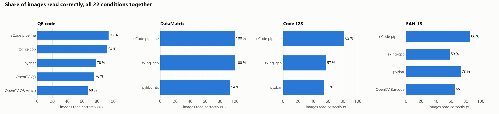
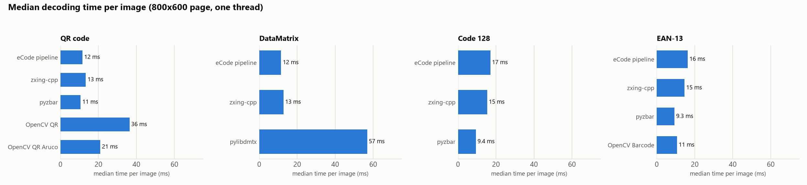
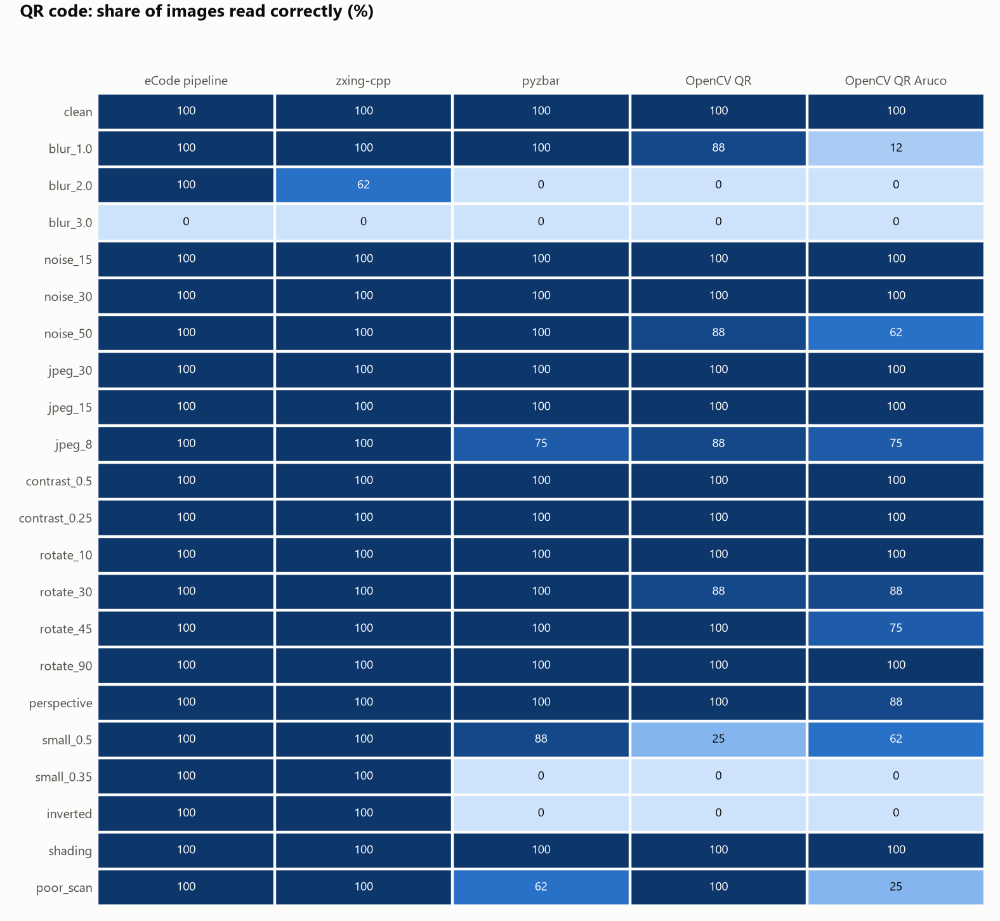
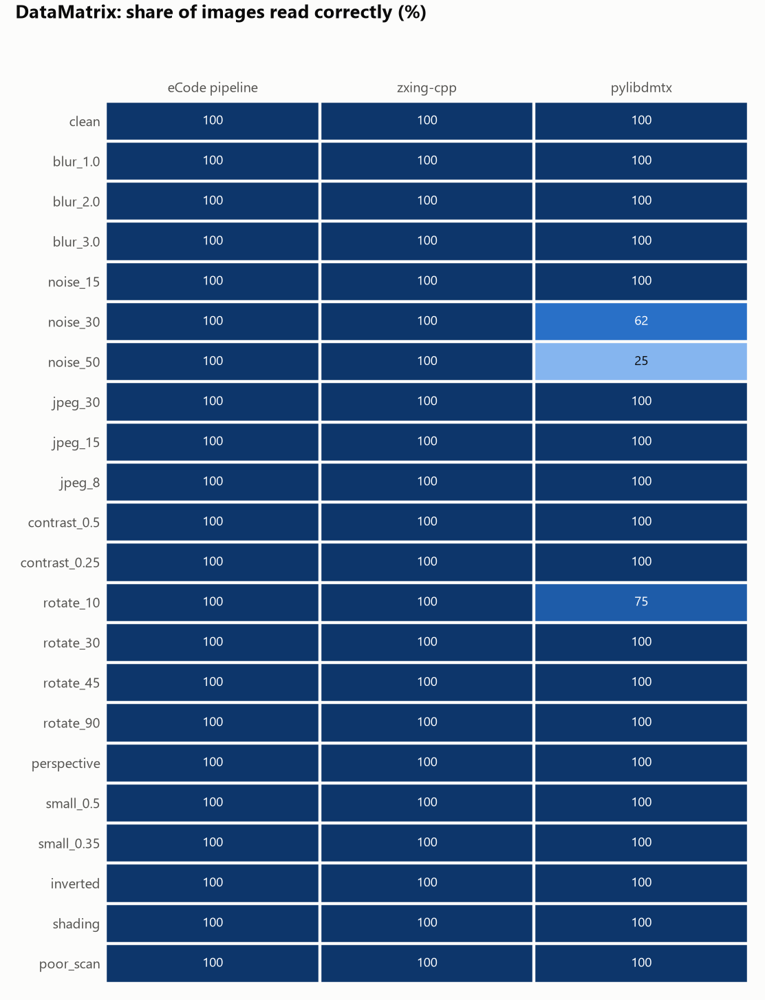
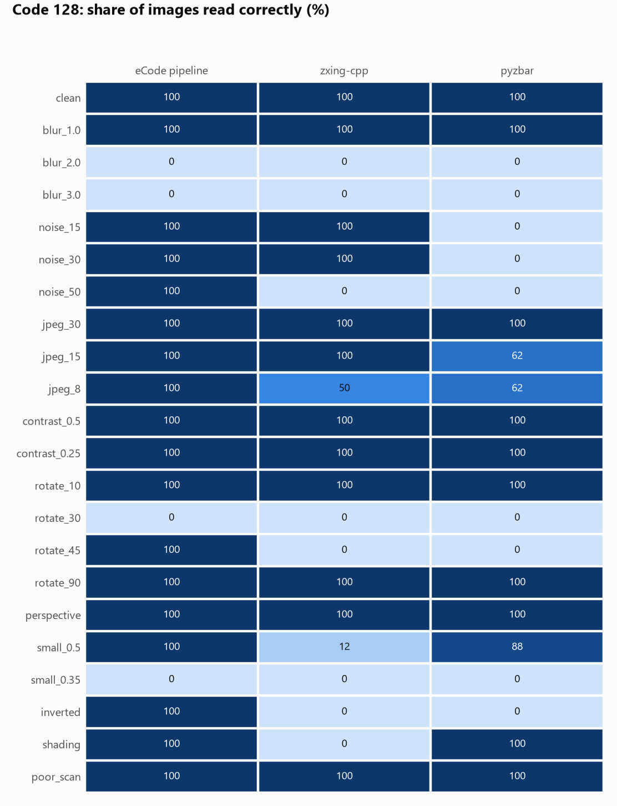
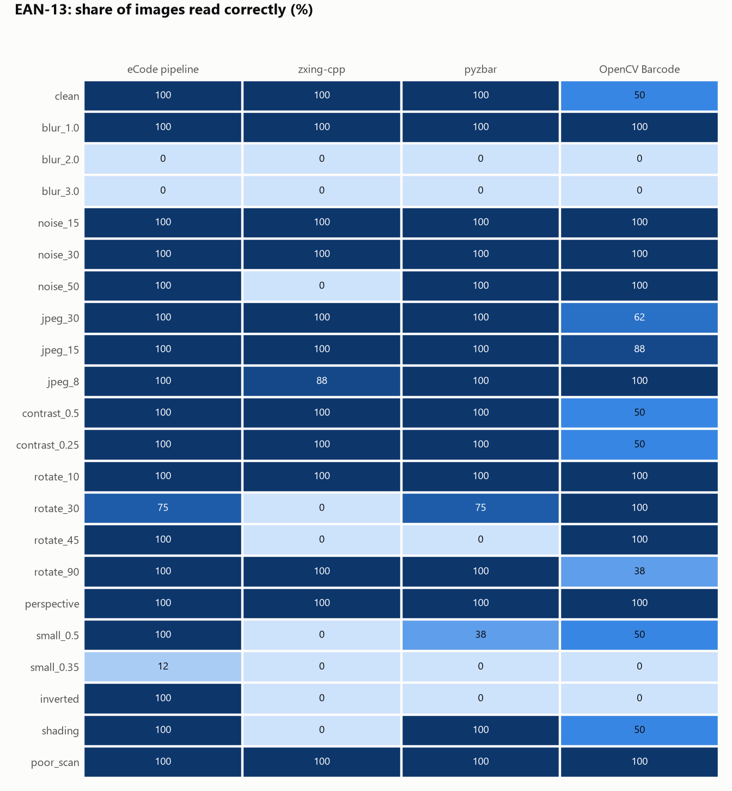

# Étude comparative des décodeurs de codes-barres (F2)

Objectif : justifier par la mesure le choix du moteur de lecture de la plateforme (zxing-cpp + passes de nettoyage),
et connaître ses limites. Tout est reproductible : `bench/make_dataset.py`, `bench/run_benchmark.py`, `bench/analyze.py`.

## 1. Méthode

**Jeu de test.** 704 images : 4 types de codes (QR code, DataMatrix, Code 128, EAN-13) × 22 conditions × 8 contenus
aléatoires. Chaque image est une page 800×600 avec **un** code. Le contenu exact est connu : un décodeur n'a juste que s'il
rend exactement ce texte. Les graines sont fixes : le jeu est identique à chaque génération.
Taille des codes : modules de 4 px (QR, DataMatrix), ≈ 3 px (1D, mesuré : 2,95 px par module sur EAN-13).

| Famille | Conditions |
|---|---|
| Référence | propre |
| Flou gaussien | σ = 1, 2, 3 |
| Bruit gaussien | σ = 15, 30, 50 |
| Compression JPEG | qualité 30, 15, 8 |
| Faible contraste | ×0,5 ; ×0,25 |
| Rotation | 10°, 30°, 45°, 90° |
| Perspective | inclinaison de la page |
| Petite taille | ×0,5 ; ×0,35 |
| Inversé | blanc sur noir |
| Éclairage inégal | dégradé fort (35 % → 100 %) |
| « Mauvais scan » | rotation 5° + flou + bruit + faible contraste + JPEG 30 |

Aperçu des conditions : `bench/figures/dataset_examples.png`.

**Décodeurs comparés.**

| Décodeur | Types lus | Réglages |
|---|---|---|
| **eCode pipeline** (notre décodeur) | tous | zxing-cpp + passes de nettoyage (inversion, contraste, binarisation, débruitage, rotations ±45°, agrandissement), budget 2 s |
| zxing-cpp 3.1.1 | tous | valeurs par défaut |
| pyzbar (ZBar) | QR, Code 128, EAN-13 | valeurs par défaut |
| pylibdmtx | DataMatrix | défaut, délai maximal 2 s par image (un dépassement compte « rien ») |
| OpenCV `QRCodeDetector` | QR | défaut |
| OpenCV `QRCodeDetectorAruco` | QR | défaut |
| OpenCV `BarcodeDetector` | EAN-13 (le module ne lit que EAN/UPC) | défaut |

Tous reçoivent la même image en niveaux de gris. Un décodeur n'est lancé que sur les types qu'il sait lire.

**Mesures.** *Lu correctement* : le texte rendu est exactement le contenu connu. *Mal lu* : un texte est rendu mais ce n'est
pas le bon (le pire cas pour un utilisateur). *Rien* : aucun résultat. *Temps* : durée de l'appel de décodage seul, un thread,
une image à la fois, après échauffement ; portable i5-7300HQ (4 cœurs).

## 2. Résultats

### Part des images lues correctement (22 conditions réunies, 176 images par type)



| Type | eCode pipeline | zxing-cpp | pyzbar | pylibdmtx | OpenCV QR | OpenCV QR Aruco | OpenCV Barcode |
|---|---|---|---|---|---|---|---|
| QR code | **95,5 %** | 93,8 % | 78,4 % | | 76,1 % | 67,6 % | |
| DataMatrix | **100 %** | **100 %** | | 93,8 % | | | |
| Code 128 | **81,8 %** | 57,4 % | 55,1 % | | | | |
| EAN-13 | **85,8 %** | 58,5 % | 73,3 % | | | | 65,3 % |

Avec 176 images par type, l'incertitude (intervalle à 95 %) est d'environ ±6 points : l'écart entre 95,5 % et 93,8 % (QR)
n'est pas significatif ; les écarts de 20 points ou plus le sont.

### Temps de décodage



| Type | eCode pipeline (médiane / p95) | zxing-cpp | pyzbar | pylibdmtx | OpenCV |
|---|---|---|---|---|---|
| QR code | 11,6 / 152 ms | 13,4 / 92 ms | 10,6 / 121 ms | | 36,4 / 66 ms (QR), 21,0 / 84 ms (Aruco) |
| DataMatrix | 11,5 / 76 ms | 12,8 / 63 ms | | 56,8 / 1993 ms | |
| Code 128 | 17,0 / 337 ms | 15,3 / 82 ms | 9,4 / 113 ms | | |
| EAN-13 | 16,3 / 315 ms | 14,6 / 88 ms | 9,3 / 116 ms | | 10,6 / 13 ms |

### Détail par condition (une carte par type)






Tableaux chiffrés complets : `bench/results/summary.md`. Résultats bruts (une ligne par image et par décodeur) :
`bench/results/results.csv`.

## 3. Ce que montrent les mesures

1. **2D : zxing-cpp est le meilleur choix.** DataMatrix : 100 % contre 93,8 % pour pylibdmtx, avec un temps médian 4,4 fois plus
   court (12,8 ms contre 56,8 ms) et sans les blocages de plusieurs secondes de pylibdmtx (p95 = 1993 ms = le délai maximal).
   QR : 93,8 % contre 78,4 % (pyzbar) et 76 % (OpenCV).
2. **Un seul moteur pour tous les types** (zxing-cpp) remplace l'ancien assemblage pyzbar + pylibdmtx : sur ce jeu, l'ancien
   assemblage donnerait 78 % (QR), 94 % (DataMatrix), 55 % (Code 128), 73 % (EAN-13), contre 95 %, 100 %, 82 %, 86 % pour
   notre décodeur.
3. **Les codes 1D sont le point faible de tous les décodeurs « tels quels ».** zxing-cpp seul lit 0 % des codes 1D inversés
   (blanc sur noir) et 0 % de ceux pris sous un éclairage inégal ; pyzbar 0 % des inversés et, sur Code 128, 0 % dès un bruit
   modéré (σ = 15). Les passes de nettoyage de notre décodeur les rattrapent (100 % dans ces trois cas) : +24 points sur
   Code 128 et +27 points sur EAN-13 par rapport à zxing-cpp seul.
4. **Le surcoût des passes n'est payé que sur les images difficiles.** Les médianes restent à 12–17 ms, mais le p95 monte à
   150–340 ms (les images qui échouent à la première passe essaient les suivantes, dans la limite de 2 s).
5. **Presque aucun décodeur ne lit** les codes 1D après un flou σ ≥ 2 (0 % partout) ni réduits à ≈ 1 px par module
   (« petite taille » ×0,35 : 0 % partout sauf 12 % pour notre décodeur sur EAN-13), ni le QR avec un flou σ = 3 (0 % partout).
   Ce sont des limites physiques du jeu de test, pas des défauts d'un décodeur en particulier.

## 4. Défauts trouvés dans notre propre décodeur

1. **Lectures fausses sur EAN-13 à 30°.** Sur 2 images, zxing-cpp seul **et** notre décodeur rendent un *autre* EAN-13 valide
   (ex. `0182200009943` au lieu de `3829942572614`) : une lecture partielle d'un code incliné qui tombe sur une clé de contrôle
   correcte, donc non détectable par la clé. 1,1 % des EAN-13 ; aucun autre décodeur n'a produit de lecture fausse dans cette
   exécution. Piste : n'accepter un code 1D incliné que si deux passes différentes rendent le même texte.
2. **Trou entre 20° et 30° sur Code 128.** Aucun décodeur ne lit le Code 128 entre 20° et 30° (0 % à 30° sur les 8 images du jeu ; essai
   supplémentaire sur une image à 20, 25, 30°) ; notre décodeur le lit à partir de 35° sur cette image d'essai, grâce à sa
   passe de rotation à ±45°. Piste : ajouter des passes à ±22° et ±30°.

Ces deux corrections sont dans le backlog (F2b, voir `docs/PROJECT_TRACKER.md`). Elles devront être réglées et vérifiées sur
**d'autres graines** que ce jeu de test, pour ne pas régler le décodeur sur les images qui servent à le noter.

## 5. Limites de l'étude (à dire au jury)

- **Images synthétiques** : codes générés puis dégradés par programme, pas de vrais scans ni photographies.
  Un code par page, fond blanc.
- **Avantage à notre décodeur** : ses passes de nettoyage ont été conçues pour des problèmes proches de plusieurs conditions
  du jeu (inversé, éclairage, rotation). La comparaison « décodeur livré tel quel » reste juste, mais on ne peut pas dire que
  notre décodeur soit meilleur « dans l'absolu ».
- **Réglages par défaut** pour les autres décodeurs : pyzbar ou OpenCV avec un prétraitement (contraste, binarisation)
  feraient mieux ; la comparaison est celle de la bibliothèque seule.
- **Petit échantillon** : 8 images par case (pas de 12,5 points par condition) ; ±6 points sur les totaux par type.
- **OpenCV `BarcodeDetector`** ne lit que EAN/UPC ; il n'est testé que sur EAN-13 (50 % sur image propre : son détecteur dépend
  de la taille du code dans l'image).
- **pylibdmtx** est limité à 2 s par image ; sans cette limite il peut chercher bien plus longtemps.
- **Une seule machine, un thread** : les temps servent à comparer les décodeurs entre eux, pas à prédire le débit du service
  (voir `docs/PERFORMANCE.md`).

### Étalonnage du jeu de test

Dans une première version, les barres des codes 1D faisaient 1 à 2 px (≈ 2 px par module) : de nombreuses conditions
(flou, petite taille, mauvais scan) donnaient 0 % à **tous** les décodeurs et n'apprenaient rien. Le jeu a été reconstruit
avec des barres de ≈ 3 px par module (balayage 300 dpi d'un module de 0,25 mm) avant toute conclusion, et toutes les mesures
ont été refaites. Le changement a été décidé parce que tous les décodeurs étaient au plancher, sans regarder lequel gagnait.

## 6. Conclusion pour le projet

- **Moteur retenu : zxing-cpp**, seul à lire tous les types, le plus rapide sur les codes 2D, et le plus précis en 2D.
- **Passes de nettoyage ajoutées au-dessus** : elles apportent le gain sur les codes 1D inversés ou mal éclairés, au prix d'un
  temps plus long uniquement sur les images où la première lecture échoue.
- **Deux défauts connus et documentés** (lectures fausses sur EAN-13 incliné, trou autour de 30°) avec une piste de correction.

## 7. Refaire l'étude

```powershell
python bench/make_dataset.py 8       # génère bench/dataset/ (≈ 85 Mo, ignoré par git) et la planche d'exemples
python bench/run_benchmark.py        # ≈ 3 minutes ; écrit bench/results/results.csv
python bench/analyze.py              # tableaux (bench/results/summary.md) et figures (bench/figures/)
```

Dépendances : `pip install -r requirements-bench.txt` (pylibdmtx, pyzbar, matplotlib). Ne rien lancer d'autre
pendant `run_benchmark.py` : les temps sont mesurés.
