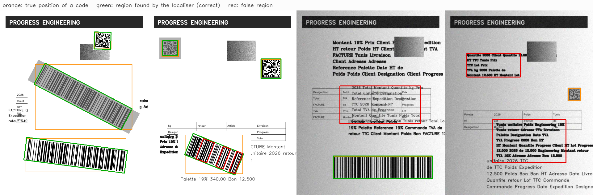

# Localisation des codes-barres (F3a)

Objectif : trouver **où** se trouvent les codes sur une page, sans les lire (le titre du projet est « localisation et
extraction »). Le module est `app/scans/localizer.py`. Il sert ensuite à (1) montrer à l'utilisateur les codes repérés
mais illisibles, (2) lire chaque région séparément (découpée, redressée, agrandie) et (3) savoir combien de codes une page
devrait contenir. Les points (1) et (2) sont l'étape suivante (F3b) : ici on mesure seulement la localisation.

## 1. Méthode

**Étape 1 : candidats.** Un code-barres est une zone où des contours noir/blanc nets sont serrés partout ; le texte et les
lignes de tableau ont aussi des contours, mais avec des vides (entre les lettres, entre les lignes). Dans une petite fenêtre
(13×13 px), le détecteur mesure la **part de pixels qui sont des contours forts**. Il le fait sur la page à deux échelles
(taille réelle et moitié), garde les zones denses, compactes et assez grandes, découpe ce qui leur est collé (une ligne de
texte, un trait de tableau) et décrit chaque zone par 12 nombres : densité, compacité, taille, forme allongée, alignement des
contours (cohérence à 180° pour les barres, à 90° pour les carrés QR et DataMatrix, quel que soit l'angle), part de pixels
sombres, échelle.

**Étape 2 : notation.** Une régression logistique (12 poids, `app/scans/localizer_model.json`, entraînée par
`bench/train_localizer.py`) transforme ces nombres en probabilité « c'est un code ». Seules les zones à plus de 50 % sont
gardées ; une même zone vue à deux échelles n'est gardée qu'une fois.

C'est du traitement d'image classique (OpenCV + NumPy), sans apprentissage profond : rapide, et chaque nombre s'explique.

## 2. Données et protocole

Les pages de l'étude F2 (un code sur une page blanche) sont le cas **facile** de la localisation. Un premier détecteur y
obtenait 100 % de détection… et 36 % seulement sur des pages réalistes. Deux familles de jeux ont donc été construites,
chacune en deux versions avec des **graines différentes** :

| Jeu | Contenu | Rôle |
|---|---|---|
| `bench/dataset` (704 images) | un code sur page blanche, 22 dégradations (jeu de l'étude F2) | **examen final** |
| `bench/documents` (240 pages, 468 codes) | pages 800×1000 : titre, paragraphes, tableau, bloc photo, 1 à 3 codes de types variés, chacun éventuellement flou, réduit, incliné, inversé ou à faible contraste ; moitié « propre », moitié « scan » (bruit, flou, éclairage inégal, JPEG) | **examen final** |
| `bench/dataset_tuning`, `bench/documents_tuning` | mêmes générateurs, autres graines (autres contenus et positions) | **réglage** : seuils et entraînement du modèle |

Règle : tout réglage (seuils, entraînement, choix d'échelles) s'est fait sur les jeux de réglage. Les jeux finaux n'ont été
évalués **qu'une fois**, à la fin. Chaque code a sa vraie position (boîte englobante) ; une détection est juste si sa boîte
recouvre la vraie avec IoU ≥ 0,5 (intersection sur union).

## 3. Résultats finaux (jeux jamais utilisés pour régler)

### Pages de documents réalistes (468 codes sur 240 pages)



*(Les quatre premières pages du jeu, sans sélection. Orange : vraie position ; vert : région trouvée ; rouge : fausse région.)*

| Mesure | Valeur |
|---|---|
| **Codes trouvés (rappel)** | **80,6 %** |
| **Précision** (régions qui sont de vrais codes) | **73,1 %** (139 fausses régions) |
| Régions rendues par page | 2,15 pour 1,95 codes |
| Temps médian (page 800×1000) | 64 ms |

| Type | QR code | DataMatrix | Code 128 | EAN-13 |
|---|---|---|---|---|
| Rappel | 98,3 % | 86,8 % | 75,0 % | 60,9 % |

| Dégradation du code | aucune | inclinée | inversée | floue | réduite | faible contraste |
|---|---|---|---|---|---|---|
| Rappel | 88,8 % | 98,2 % | 91,5 % | 82,7 % | 70,5 % | 67,3 % |

Page « propre » : 85,3 % trouvés ; page « scan » : 75,9 %.

### Un code sur page blanche (704 images, 22 dégradations)

Rappel 76,1 %, précision 68,0 %, 1,12 région par image, 25 ms.

| Type | QR code | DataMatrix | Code 128 | EAN-13 |
|---|---|---|---|---|
| Rappel | 99,4 % | 68,8 % | 84,1 % | 52,3 % |

Bien trouvés (≥ 90 %) : rotation 10° et 30° (96,9 %), perspective (93,8 %), bruit fort σ = 50 (93,8 %), rotation 45° (90,6 %).
Mal trouvés : faible contraste (34,4 % et 25,0 %), éclairage inégal (56,2 %), flou σ = 3 (50 %).

### Réglage et examen final concordent (pas de sur-apprentissage)

| Jeu | Rappel réglage | Rappel final | Précision réglage | Précision final |
|---|---|---|---|---|
| Pages de documents | 76,8 % | 80,6 % | 75,0 % | 73,1 % |
| Un code sur page blanche | 82,1 % | 76,1 % | 77,5 % | 68,0 % |

Les écarts viennent de l'échantillonnage (les jeux sont petits), pas d'un modèle collé au jeu de réglage.

## 4. Comment on y est arrivé (jeu de réglage, pages de documents)

| Étape | Rappel | Précision | Régions/page | Temps |
|---|---|---|---|---|
| 1. Énergie des contours + seuil d'Otsu | 36,3 % | 10,6 % | 6,65 | 107 ms |
| 2. Part de contours forts dans une fenêtre (3 échelles) | 76,8 % | 4,5 % | 33 | 296 ms |
| 3. Taille minimale 28 px | 76,8 % | 17,3 % | 8,6 | 88 ms |
| 4. + notation par régression logistique | 70,1 % | 66,1 % | 2,05 | 114 ms |
| 5. + découpe de ce qui est collé au code | 76,3 % | 66,1 % | 2,24 | 135 ms |
| 6. Deux échelles au lieu de trois + optimisations | 76,8 % | 75,0 % | 1,98 | 64 ms |

Compromis connus, mesurés sur le jeu de réglage :
- **Découpe** : +6 points de rappel sur les documents, −4,5 points sur les codes isolés (retenue : les documents sont le cas réaliste).
- **Échelle ¼ supprimée** : précision +9 points sur les documents (66 → 75 %), mais rappel −4,7 points sur les codes isolés.
  Cela explique le rappel de 68,8 % des DataMatrix de l'étude F2 : ils y mesurent 320 px de large (modules de 20 px, taille par
  défaut du générateur), bien plus que sur un vrai document (modules d'environ 6 px : rappel 86,8 % sur les pages de documents).

## 5. Limites (à dire au jury)

- **Données synthétiques** : codes générés, textes dessinés avec des polices Hershey, aucun vrai scan ni photo. Le modèle a appris
  ces polices et ces codes : sur de vrais documents (autres polices, logos, photos, plis, ombres), les chiffres peuvent être
  différents. Aucune mesure n'a été faite sur de vraies images.
- **Fausses régions** : surtout du texte gras et des paragraphes denses (voir la figure) ; un code est parfois coupé en morceaux.
- **Codes 1D** moins bien trouvés que les codes 2D (EAN-13 : 60,9 %) ; faible contraste et éclairage inégal restent difficiles.
- **Boîtes approximatives** : IoU moyen entre 0,6 et 0,9 selon le type ; suffisant pour découper une région, pas pour mesurer.
- **Temps** : 64 ms sur une page 800×1000 (portable i5, un thread) : trop long pour tourner à chaque requête. Usage prévu :
  seulement quand la lecture rapide ne trouve rien ou moins de codes que prévu (F3b).
- Les pages ont des codes **sans chevauchement** ; le cas de codes qui se touchent n'est pas couvert.

## 6. Refaire l'étude

```powershell
python bench/make_dataset.py 8                 # bench/dataset (examen final, graines d'origine)
python bench/make_dataset.py 8 tuning          # bench/dataset_tuning (réglage)
python bench/make_documents.py 120             # bench/documents (examen final)
python bench/make_documents.py 120 tuning      # bench/documents_tuning (réglage)
python bench/train_localizer.py                # entraîne le modèle sur les jeux de RÉGLAGE uniquement
python bench/eval_localizer.py bench/documents # score sur un jeu (le jeu final ne doit servir qu'à la fin)
```
